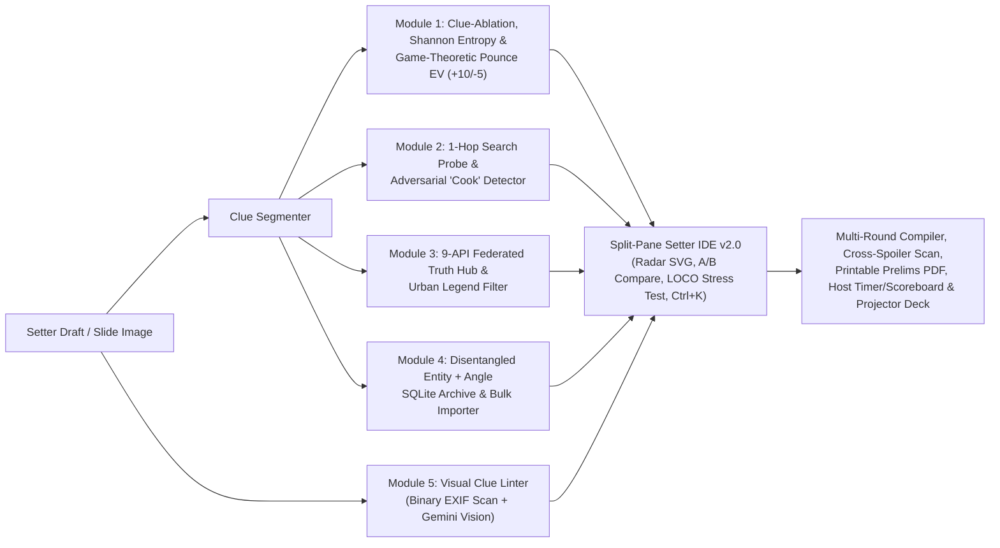

# CRUCIBLE // Q-Lint — Competitive Quizmaster Diagnostic IDE

[](https://github.com/JosephJonathanFernandes/qlint-quizmaster-ide/actions/workflows/ci.yml)

> **AI-Assisted Question Quality Control, Clue-Ablation Workability Linter & Multi-API Federated Truth Engine**  
> Built for competitive quiz circuits (**KQA**, **BQC**, **QFI**, **Nihilanth**, **Campus Open Quizzes**) and engineered with **Groq LPU** (`llama-3.3-70b-versatile` & `llama-3.1-8b-instant`), **Google Gemini** (`gemini-2.5-flash` text + multimodal vision), and **9 Federated Truth-Finding APIs**.

---

## System Architecture



---

## Complete Feature Matrix

### 5 Core Diagnostic Modules
1. **Module 1 — Clue-Ablation Workability Funnel, Shannon Entropy & Game-Theoretic Pounce EV**
   - Progressive blinded solving across **Gemini 2.5 Flash** (Veteran), **Groq Llama-3.3-70B** (Lateral), and **Groq Llama-3.1-8B** (Campus).
   - Plots Shannon entropy decay $H(A \mid c_{1..i})$, **Game-Theoretic Pounce EV** ($EV = 15p - 5$, $33.3\%$ breakeven), and a **100-Team Tournament Floor Crack Distribution** (Pounce / Bounce / Pass %).
   - Includes **Leave-One-Clue-Out (LOCO) Keystone Stress Testing** and an **Implicit Linguistic Leak Audit** (gendered pronouns, year clustering, verbatim quotes).
2. **Module 2 — Single-Hop Googleability Probe & Adversarial "Cook" Detector**
   - Fires masked clauses against live search APIs to detect 1-hop leaks and suggests 2-hop oblique rewrites.
   - Hunts for competing unintended answers $A' \neq A^*$ ("cooks") such as *John Polidori (The Vampyre)* on an under-constrained 1816 Villa Diodati prompt.
3. **Module 3 — 9-API Federated Truth-Finding Hub & Urban Legend Filter**
   - Parallel async grounding across **Wikipedia REST**, **Wikipedia Search**, **Wikidata KG**, **DuckDuckGo**, **OpenAlex**, **OpenLibrary**, **CrossRef**, **Free Dictionary API**, plus optional **Tavily** and **Serper** keys.
4. **Module 4 — Disentangled "Angle-Aware" Archive Deduplication & Bulk Importer**
   - SQLite archive separating `target_entity` frequency from `canonical_funda` angle similarity, with raw text/Markdown/JSON bulk import.
5. **Module 5 — Visual / Image-Clue Linter**
   - Zero-dependency binary EXIF/PNG metadata & filename spoiler scanner + projector resolution check + **Gemini 2.5 Flash Multimodal Vision** watermark/OCR inspection.

### End-to-End Quizmaster & Co-Setter Workbench
- **⛏ Funda Miner:** Mines 3 ranked lateral angles per entity and ranks `FRESH ANGLE` ahead of `ARCHIVE OVERUSED`.
- **⚖ Side-by-Side A/B Variant Comparator:** Concurrently lints Draft A vs. Draft B to settle co-setter debates with data.
- **🔽/🔼 Difficulty Re-Calibrator & AI Autofix:** Surgical `De-Googleify`, `Block Cook`, `Fix Myth`, `Campus Prelims (Easier)`, and `KQA Finals (Harder)` rewrites with Before/After Diff & Version Snapshots.
- **🔊 Stage Mic TTS Read-Aloud & Oral Cadence Linter:** Hear how questions sound on a microphone and catch long breath clauses (`>38w`).
- **🎯 Live Pounce Playtest Simulator:** Playtest clue-by-clue (`+10/-5` Pounce vs. `+10/0` Bounce) against Gemini & Groq.
- **🕸 2-Hop Connect Builder & 📜 List-It / Bidding Round Verifier:** Wikidata graph connects with SVG topology + finite-list cardinality & boundary arbitration.
- **📋 Multi-Round Compiler, Host Scoreboard & Exporters:** Cross-question spoiler detection, batch round linting, pacing SVG curve, **🖨 Printable Prelims PDF / Master Answer Key**, **📝 Fuzzy Prelims Sheet Grader**, **🏆 Live Host Scoreboard with 30s/15s Web Audio Buzzer Timer**, **🎬 Standalone Projector HTML Slide Deck**, and **💾/📂 Portable Workspace JSON Backup/Restore**.
- **📊 CSE Academic Evaluation Suite:** 5-case empirical benchmark with 1-click **IEEE/ACM LaTeX Table** and **CSV** export.

---

## Quickstart

### Option 1: One-Command Launchers
```powershell
# Windows (PowerShell)
.\run.ps1
```
```bash
# macOS / Linux
chmod +x run.sh && ./run.sh
```

### Option 2: Docker Compose
```bash
docker compose up --build
```

Open **http://127.0.0.1:8000** (or **/docs** for Interactive FastAPI OpenAPI Swagger UI) and click **⚙ Keys** to configure your `GROQ_API_KEY` and `GEMINI_API_KEY`.

---

## Automated Tests (`19/19` Passing)

```powershell
pytest -v
```
