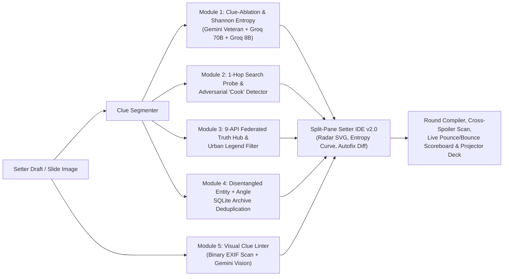

# CRUCIBLE // Q-Lint — Competitive Quizmaster Diagnostic IDE

[](https://github.com/JosephJonathanFernandes/qlint-quizmaster-ide/actions/workflows/ci.yml)

> **AI-Assisted Question Quality Control, Clue-Ablation Workability Linter & Multi-API Federated Truth Engine**  
> Built for competitive quiz circuits (**KQA**, **BQC**, **QFI**, **Nihilanth**, **Campus Open Quizzes**) and engineered with **Groq LPU** (`llama-3.3-70b-versatile` & `llama-3.1-8b-instant`), **Google Gemini** (`gemini-2.5-flash` text + multimodal vision), and **9 Federated Truth-Finding APIs**.

---

## System Architecture



---

## Core Modules & Capabilities

1. **Module 1 — Clue-Ablation Workability Funnel & Shannon Entropy Curve**
   - Segments draft questions into ordered atomic clues $c_1 \dots c_k$ and runs progressive blinded solving across **Gemini 2.5 Flash**, **Groq Llama-3.3-70B**, and **Groq Llama-3.1-8B**.
   - Plots Shannon entropy decay $H(A \mid c_{1..i})$ in bits and flags `PREMATURE_GIVEAWAY`, `DEAD_WEIGHT`, `OPTIMAL_NARROWING`, or `FINAL_LOCK`.
2. **Module 2 — Single-Hop Googleability Probe & Adversarial "Cook" Detector**
   - Fires masked clauses against live search APIs to detect 1-hop search leaks and suggests 2-hop oblique rewrites.
   - Hunts for unintended competing valid answers $A' \neq A^*$ ("cooks") such as *John Polidori (The Vampyre)* on an under-constrained 1816 Villa Diodati prompt.
3. **Module 3 — 9-API Federated Truth-Finding Hub & Urban Legend Filter**
   - Parallel async grounding across **Wikipedia REST**, **Wikipedia Search**, **Wikidata KG**, **DuckDuckGo**, **OpenAlex**, **OpenLibrary**, **CrossRef**, **Free Dictionary API**, plus optional **Tavily** and **Serper** keys.
   - Flags notorious apocryphal quiz myths (e.g., *"Einstein failed high-school math"*, *"Percy Shelley's calcified heart vs. liver debate"*).
4. **Module 4 — Disentangled "Angle-Aware" Archive Deduplication & Bulk Importer**
   - SQLite archive separating `target_entity` frequency from `canonical_funda` angle similarity, with raw text/Markdown/JSON bulk import.
5. **Module 5 — Visual / Image-Clue Linter**
   - Pure-Python binary EXIF/PNG metadata & filename spoiler scanner + projector resolution check + **Gemini 2.5 Flash Multimodal Vision** watermark/OCR inspection.
6. **End-to-End Setter & Host Suite**
   - **⛏ Funda Miner:** Mines 3 ranked lateral angles per topic and ranks `FRESH ANGLE` ahead of `ARCHIVE OVERUSED`.
   - **🎯 Live Pounce Playtest Simulator:** Playtest clue-by-clue (`+10/-5` Pounce vs. `+10/0` Direct Bounce) against Gemini & Groq.
   - **🕸 2-Hop Connect Builder:** Wikidata/Wikipedia graph connect synthesis with SVG topology map.
   - **📋 Round Compiler & 🏆 Live Host Scoreboard:** Batch-lints full rounds, detects cross-question spoilers, plots round pacing curves, exports Markdown audit reports, and launches a standalone projector HTML slide deck.

---

## Quickstart

```powershell
# 1. Create and activate virtual environment
python -m venv .venv
.venv\Scripts\activate

# 2. Install dependencies
pip install -r requirements.txt

# 3. (Optional) Configure GEMINI_API_KEY and GROQ_API_KEY in .env
#    You can also paste keys live inside the UI via the "⚙ Keys" modal!
copy .env.example .env

# 4. Run the Full-Stack IDE
uvicorn backend.main:app --host 127.0.0.1 --port 8000 --reload
```

Open **http://127.0.0.1:8000** in your browser.

---

## Automated Tests

```powershell
pytest -v
```
